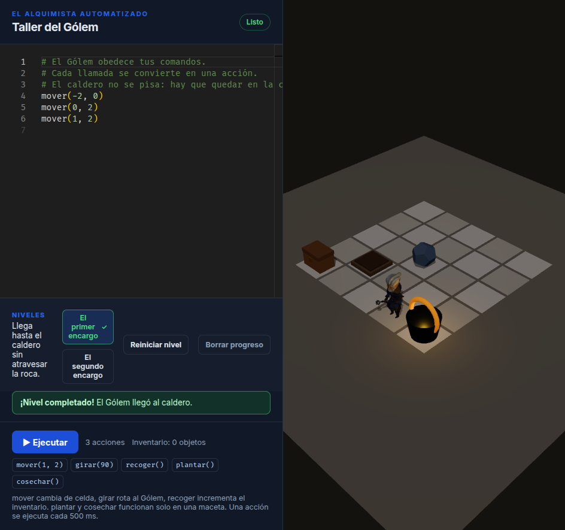

# El Alquimista Automatizado

Juego educativo de programación y lógica. El jugador escribe Python para controlar a un Gólem en un taller 3D.

[](https://github.com/Andres-Developer-23/alquimista-automatizado/actions/workflows/ci.yml)
[](https://github.com/Andres-Developer-23/alquimista-automatizado/actions/workflows/deploy-pages.yml)

**Demo:** https://andres-developer-23.github.io/alquimista-automatizado/



## Qué incluye el MVP

- Editor Monaco configurado para Python.
- Escena 3D con React Three Fiber: tablero de 5x5 con baldosas de piedra, macetas mágicas, caldero, cofre y Gólem con modelo CC0 bajo poli.
- Movimiento animado entre celdas y rotación del Gólem, sincronizados con el tick de 500 ms.
- Errores de Python clasificados y mostrados en un panel legible.
- Pyodide ejecutándose dentro de un Web Worker de módulo.
- Funciones Python inyectadas (`mover(x, y)`, `girar(grados)`, `recoger()`, `plantar()` y `cosechar()`) que generan un arreglo JSON de acciones.
- Inventario lógico de `recoger()` y `cosechar()` visible en la UI.
- Botón **Ejecutar** que envía el código al Worker y muestra la respuesta en la consola.
- Base configurada para publicar en GitHub Pages.

## Stack

| Capa | Tecnología |
| --- | --- |
| Build | Vite |
| UI | React |
| Editor | `@monaco-editor/react` |
| 3D | `@react-three/fiber`, `@react-three/drei`, Three.js |
| Python | Pyodide 0.25.0 desde CDN |
| Aislamiento | Web Worker de módulo |
| Tests | Vitest + Testing Library |
| CI/CD | GitHub Actions + GitHub Pages |

## Inicio rápido

Requisitos: Node.js 22+ y npm 10+.

```bash
git clone https://github.com/Andres-Developer-23/alquimista-automatizado.git
cd alquimista-automatizado
npm ci
npm run dev
```

Abrir la URL que imprime Vite. En desarrollo la app vive bajo el `base` configurado:

```text
http://localhost:5173/alquimista-automatizado/
```

## Scripts

```bash
npm run dev        # servidor local
npm run build      # build de producción
npm run preview    # previsualizar el build
npm run lint       # ESLint
npm test           # tests una vez
npm run test:watch # tests en modo watch
```

## Cómo funciona

```text
Editor Python
    │  postMessage({ type: 'run', code })
    ▼
Web Worker
    │  Pyodide evalúa el código con mover(), girar() y recoger() inyectados
    │  json.dumps(actions)
    ▼
React
    │  normalizeActions()
    │  console.log(acciones)
    ▼
(fase 2) cola de acciones + ticks de 500 ms + animación 3D
```

Regla crítica: el código del jugador **nunca** debe bloquear la UI. No se usa `time.sleep`; cada comando se transforma en un dato que React procesa después, tick a tick.

Contrato actual del Worker:

```json
{
  "type": "result",
  "actions": [
    { "action": "MOVER", "x": 1, "y": 2 },
    { "action": "GIRAR", "grados": 90 },
    { "action": "RECOGER" }
  ]
}
```

Comandos inyectados en Python:

```python
mover(1, 2)
girar(90)
recoger()
plantar()
cosechar()
```

`plantar()` y `cosechar()` solo funcionan si el Gólem está en una maceta. Las estaciones fijas (caldero y cofre) no se pueden pisar: el Gólem se sitúa en la casilla de al lado para interactuar.

## Estructura del proyecto

```text
src/
├── app/                 # composición de la aplicación y estilos de pantalla
├── components/
│   ├── editor/          # Monaco
│   ├── scene/           # Canvas R3F, suelo, paredes, grid y Gólem
│   └── ui/              # controles reutilizables
├── engine/
│   ├── actions/         # contrato, validación y cola de acciones
│   ├── tick/            # motor de ticks de 500 ms
│   └── python/          # puente con el Web Worker
├── hooks/               # estado de React y ciclo de vida del Worker
├── levels/              # definiciones de nivel en JSON
├── styles/              # estilos globales y tokens
└── workers/             # Pyodide + intérprete Python
public/
└── models/              # modelos 3D CC0 (golem.glb)
```

Más detalle en [docs/ARCHITECTURE.md](docs/ARCHITECTURE.md).

## Documentación

- [Arquitectura](docs/ARCHITECTURE.md)
- [Roadmap](docs/ROADMAP.md)
- [Setup y despliegue](docs/SETUP.md)
- [Catálogo de assets 3D](docs/ASSETS.md)
- [Créditos de assets](CREDITS.md)
- [Guía de contribución](CONTRIBUTING.md)
- [Decisiones de arquitectura](docs/adr/)
- [Changelog](CHANGELOG.md)
- [Seguridad](SECURITY.md)

## Despliegue

El workflow `deploy-pages.yml` publica `dist/` en GitHub Pages al hacer push a `main`. La base de Vite debe coincidir con el nombre del repositorio:

```js
base: '/alquimista-automatizado/'
```

Pasos completos en [docs/SETUP.md](docs/SETUP.md).

## Roadmap resumido

1. **Fase 1:** scaffolding, editor, escena, Worker y conexión UI.
2. **Fase 2:** cola de acciones, ticks de 500 ms, movimiento animado y errores Python.
3. **Fase 3:** niveles, objetivos y validación.
4. **Fase 4:** pulido visual, accesibilidad, sonido y release.

Ver [docs/ROADMAP.md](docs/ROADMAP.md).

## Contribuir

Se aceptan issues y pull requests. Antes de abrir un PR, revisar [CONTRIBUTING.md](CONTRIBUTING.md).

## Licencia

[MIT](LICENSE) © 2026 Andres Felipe Bravo Navarro
