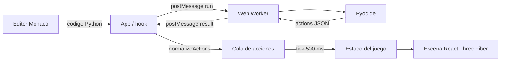
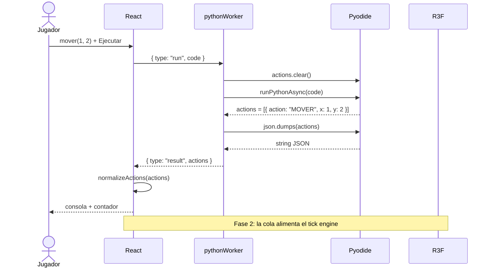

# Arquitectura

## 1. Objetivo

El Alquimista Automatizado enseña programación mediante un ciclo corto:

1. El jugador escribe Python.
2. El código produce acciones de juego.
3. El Gólem ejecuta esas acciones en una escena 3D.

El sistema está diseñado para que la ejecución de Python sea **asíncrona y no bloqueante** para la interfaz.

## 2. Principios

- **Separación de responsabilidades:** UI, comunicación, ejecución Python y lógica de juego viven en módulos distintos.
- **Contrato explícito:** React y el Worker solo intercambian mensajes con una forma conocida.
- **Datos antes que efectos:** Python genera datos; React decide cuándo y cómo animarlos.
- **Un solo camino para el estado:** las acciones válidas entran al motor; las inválidas se descartan y se reportan.
- **Cambios pequeños y verificables:** cada funcionalidad debe poder probarse sin depender del navegador completo.

## 3. Vista de alto nivel



La cola y los ticks alimentan el estado del juego; `MOVER` desplaza al Gólem (sin pisar obstáculos ni estaciones fijas), `GIRAR` rota su Mesh, `RECOGER` incrementa el inventario, y `PLANTAR`/`COSECHAR` gestionan las macetas mágicas. La victoria se alcanza al quedar en la casilla de al lado de la estación objetivo.

## 4. Flujo de una ejecución



### Mensajes permitidos

| Dirección | Mensaje | Campos | Uso |
| --- | --- | --- | --- |
| UI → Worker | `run` | `code: string` | Ejecutar código del jugador |
| Worker → UI | `ready` | — | Pyodide terminó de inicializar |
| Worker → UI | `result` | `actions: Action[]` | Acciones producidas |
| Worker → UI | `error` | `message: string`, `error: PythonErrorInfo` | Error de Python o de inicialización |

### Contrato de error

```ts
type PythonErrorInfo = {
  type: 'syntax' | 'runtime' | 'initialization'
  title: string
  message: string
  line: number | null
  hint: string
  details: string
}
```

`formatPythonError()` convierte tracebacks crudos en este contrato. La UI usa solo los campos legibles y mantiene `details` en un bloque plegable.

### Contrato de acción

```ts
type MoveAction = {
  action: 'MOVER'
  x: number
  y: number
}

type TurnAction = {
  action: 'GIRAR'
  grados: number
}

type CollectAction = {
  action: 'RECOGER'
}

type PlantAction = {
  action: 'PLANTAR'
}

type HarvestAction = {
  action: 'COSECHAR'
}

type GameAction = MoveAction | TurnAction | CollectAction | PlantAction | HarvestAction
```

Reglas:

- `x` e `y` deben ser enteros.
- `GIRAR` acepta un número finito en `grados`; `RECOGER`, `PLANTAR` y `COSECHAR` no llevan campos adicionales.
- Las acciones desconocidas o inválidas se descartan en `normalizeActions`.
- El Worker no conoce el estado del juego; solo traduce Python a datos.

### Macetas y estaciones

- **Macetas** (`level.planters`): celdas transitables donde `plantar()` deja la maceta en `planted` y `cosechar()` solo funciona cuando está `grown`. El crecimiento avanza un paso al inicio de cada tick (`planted` → `grown`).
- **Estaciones** (`level.stations`): celdas **no transitables** de tipo `cauldron` (meta) u `hopper` (cofre). El Gólem no puede pisarlas; se sitúa en la casilla de al lado para interactuar.
- **Victoria**: `isAdjacent(position, goal)` es verdadero, es decir, ortogonalmente adyacente a la meta.

## 5. Responsabilidades por carpeta

| Ruta | Responsabilidad | No debe hacer |
| --- | --- | --- |
| `src/app` | Componer la pantalla y conectar hooks | Ejecutar Python directamente |
| `src/components/editor` | Configurar Monaco | Conocer el protocolo del Worker |
| `src/components/scene` | Renderizar tablero, suelo, paredes y entidades | Decidir reglas del juego |
| `src/components/ui` | Controles visuales reutilizables | Manejar estado global |
| `src/engine/actions` | Definir tipos, validar acciones y encolar | Renderizar |
| `src/engine/tick` | Consumir la cola por ticks | Conocer React o el DOM |
| `src/engine/python` | Crear el Worker | Interpretar reglas de juego |
| `src/hooks` | Ciclo de vida y estado de React | Contener lógica de Pyodide |
| `src/workers` | Cargar Pyodide y ejecutar código | Acceder al DOM |
| `src/styles` | Tokens y estilos globales | Lógica |

## 6. Diseño del Worker

`pythonWorker.js` es un **worker de módulo** porque Pyodide carga sus assets como módulos ES desde el CDN. El Worker se crea con `type: 'module'`.

Decisiones:

- **Una sola instancia de Pyodide:** la carga inicial es costosa; se reutiliza entre ejecuciones.
- **`pyodidePromise`:** evita inicializaciones duplicadas si llegan mensajes concurrentes.
- **`actions.clear()` antes de cada ejecución:** cada corrida produce un resultado independiente.
- **Serialización con `json.dumps`:** evita ambigüedades de conversión entre objetos Python y JavaScript.
- **Errores capturados:** cualquier excepción se devuelve como `PythonErrorInfo`, no como crash del worker.

### Limitaciones conocidas

- Pyodide se descarga desde un CDN externo; sin conexión no hay intérprete.
- El código del jugador puede consumir CPU. El Worker evita bloquear la UI, pero no impone límites de tiempo o memoria.
- Un Worker no es un sandbox de seguridad frente a código malicioso. La aplicación está pensada para código propio del jugador, no para ejecutar código de terceros.

## 7. Estado de React

`usePythonWorker` es la frontera entre React y el Worker. `useGameEngine` es la frontera entre las acciones y el estado del juego.

Estado de `usePythonWorker`:

- `status`: `loading | ready | running | error`.
- `lastResponse`: última lista de acciones válidas.
- `error`: último `PythonErrorInfo` o un objeto equivalente de inicialización.

Reglas:

- El Worker se crea al montar y se termina al desmontar.
- `run()` limpia errores y marca el estado como `running`.
- La respuesta se valida antes de guardarla.
- El `console.log` de la respuesta es parte del contrato de la fase 1.
- `PythonErrorPanel` distingue `syntax`, `runtime` e `initialization` y muestra línea, sugerencia y detalle plegable.

`useGameEngine` expone `position`, `rotation`, `inventory`, `isPlaying`, `play(actions)` y `stop()`:

- `play()` cancela la reproducción anterior, reinicia la posición, la rotación y el inventario, vacía la cola y encola las acciones nuevas.
- `stop()` detiene el temporizador y descarta las acciones pendientes sin reiniciar el estado visible.
- La posición objetivo se actualiza cuando el tick engine consume una acción y se limita a las coordenadas `-2..2` del tablero.
- `GIRAR` normaliza los grados a un giro de `0..359`; `RECOGER` incrementa el inventario lógico.
- `isPlaying` se mantiene activo durante el último tick para que la animación termine antes de mostrar `Listo`.

## 8. Sistema de ticks

El motor es determinista:

```text
lastResponse -> cola FIFO -> tick cada 500 ms -> posición / rotación / inventario -> escena
```

Componentes:

- `createActionQueue()` mantiene una cola FIFO con `enqueue`, `enqueueAll`, `dequeue`, `clear`, `size`, `isEmpty` y `toArray`.
- `createTickEngine()` expone `start()`, `stop()` e `isRunning`.
- Cada tick consume **una** acción y llama `onTick(action)`.
- Al vaciarse la cola, el motor se detiene y llama `onComplete()`.
- El scheduler se inyecta en los tests; por defecto usa `setInterval` y `clearInterval`.

`Golem` interpola visualmente hacia la posición objetivo con `useFrame` y amortiguación exponencial (`lambda = 12`), de modo que recorre una celda en aproximadamente 500 ms sin sobrepasarla; los giros usan el camino angular más corto. La interpolación es monótona: si la posición lógica está dentro del tablero, el Gólem tampoco sale de él. No se debe usar `time.sleep` ni bucles de espera dentro del código Python.

## 9. Escena 3D

- `AlchemistScene` monta el `Canvas` con sombras habilitadas, luces, suelo, paredes, grid y controles de órbita.
- **Suelo:** `PlaneGeometry` de 12x12 en `y = 0`, recibe sombras, color gris pizarra (`#475569`).
- **Paredes:** cuatro `BoxGeometry` delgadas en los bordes del tablero (±2.6), altura 1.2, color gris oscuro (`#334155`), reciben y proyectan sombras.
- **Luz direccional:** proyecta sombras con mapa de 1024x1024.
- `Golem` recibe la posición y orientación objetivo desde `useGameEngine`, se dibuja en `[x, 0.5, y]` y se mueve/rota con `useFrame`. Usa un modelo CC0 bajo poli cargado desde `public/models/golem.glb` mediante `useGLTF`.
- El grid usa `GridHelper` con tamaño 5 y 5 divisiones; las celdas válidas van de `-2` a `2`.
- La cámara y los controles están limitados para evitar vistas confusas.

## 10. Build y despliegue

- Vite compila la app con `base: '/alquimista-automatizado/'`.
- El Worker se empaqueta como asset separado mediante `new Worker(new URL(...))`.
- El modelo 3D del Gólem se sirve desde `public/models/golem.glb`, accesible bajo la base de Vite.
- GitHub Actions ejecuta lint, tests y build en cada PR.
- El workflow de Pages publica `dist/` al hacer push a `main`.

## 11. Testing

Niveles:

1. **Unitario:** validación y normalización de acciones.
2. **Componentes:** render de controles y mensajes de estado.
3. **Integración:** protocolo del Worker con un mock.
4. **E2E (fase 2):** flujo editor → Worker → tick → escena.

Los tests deben ser rápidos y no depender de la red ni del CDN de Pyodide.

## 12. Decisiones relacionadas

- [ADR 0001: Stack tecnológico](adr/0001-stack-tecnologico.md)
- [ADR 0002: Pyodide en Web Worker](adr/0002-pyodide-en-web-worker.md)
- [ADR 0003: Cola de acciones y ticks](adr/0003-cola-de-acciones-y-ticks.md)
