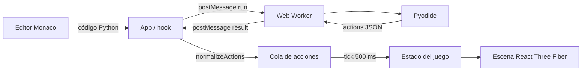
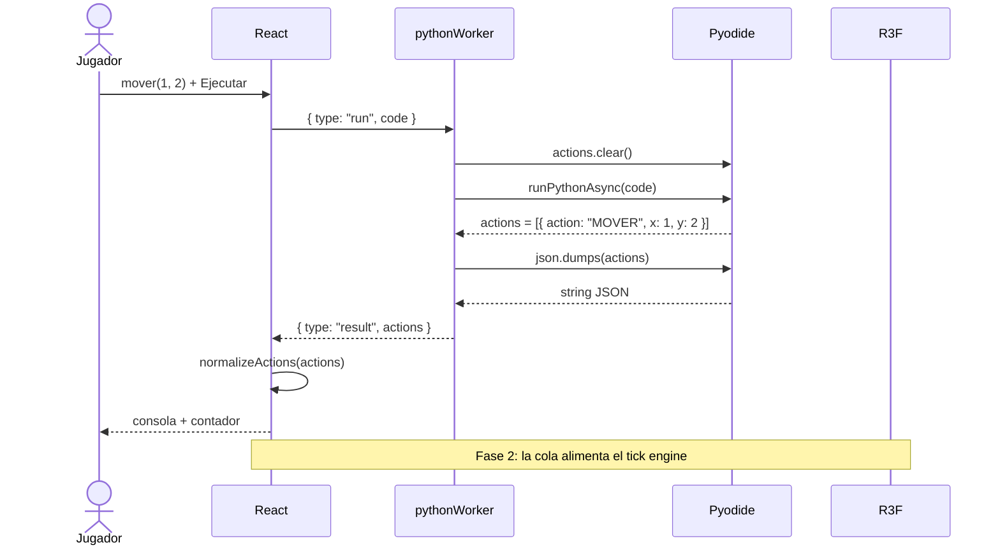

# Arquitectura

## 1. Objetivo

El Alquimista Automatizado enseña programación mediante un ciclo corto:

1. El jugador escribe Python.
2. El código produce acciones de juego.
3. El Gólem ejecuta esas acciones en una escena 3D.

El sistema está diseñado para que la ejecución de Python sea **asíncrona y no bloqueante** para la interfaz.

## 2. Principios

- **Separación de responsabilidades:** UI, comunicación, ejecución Python y lógica de juego viven en módulos distintos.
- **Contrato explícito:** React y el Worker solo intercambian mensajes con una forma conocida.
- **Datos antes que efectos:** Python genera datos; React decide cuándo y cómo animarlos.
- **Un solo camino para el estado:** las acciones válidas entran al motor; las inválidas se descartan y se reportan.
- **Cambios pequeños y verificables:** cada funcionalidad debe poder probarse sin depender del navegador completo.

## 3. Vista de alto nivel



En la fase actual, la cola y los ticks todavía no están implementados. El resultado se registra en consola y se muestra el número de acciones.

## 4. Flujo de una ejecución



### Mensajes permitidos

| Dirección | Mensaje | Campos | Uso |
| --- | --- | --- | --- |
| UI → Worker | `run` | `code: string` | Ejecutar código del jugador |
| Worker → UI | `ready` | — | Pyodide terminó de inicializar |
| Worker → UI | `result` | `actions: Action[]` | Acciones producidas |
| Worker → UI | `error` | `message: string` | Error de Python o de inicialización |

### Contrato de acción

```ts
type MoveAction = {
  action: 'MOVER'
  x: number
  y: number
}
```

Reglas:

- `x` e `y` deben ser enteros.
- Las acciones desconocidas se descartan en `normalizeActions`.
- El Worker no conoce el estado del juego; solo traduce Python a datos.

## 5. Responsabilidades por carpeta

| Ruta | Responsabilidad | No debe hacer |
| --- | --- | --- |
| `src/app` | Componer la pantalla y conectar hooks | Ejecutar Python directamente |
| `src/components/editor` | Configurar Monaco | Conocer el protocolo del Worker |
| `src/components/scene` | Renderizar tablero y entidades | Decidir reglas del juego |
| `src/components/ui` | Controles visuales reutilizables | Manejar estado global |
| `src/engine/actions` | Definir tipos y validar acciones | Renderizar |
| `src/engine/python` | Crear el Worker | Interpretar reglas de juego |
| `src/hooks` | Ciclo de vida y estado de React | Contener lógica de Pyodide |
| `src/workers` | Cargar Pyodide y ejecutar código | Acceder al DOM |
| `src/styles` | Tokens y estilos globales | Lógica |

## 6. Diseño del Worker

`pythonWorker.js` es un **worker clásico** porque usa `importScripts()` para cargar Pyodide desde el CDN.

Decisiones:

- **Una sola instancia de Pyodide:** la carga inicial es costosa; se reutiliza entre ejecuciones.
- **`pyodidePromise`:** evita inicializaciones duplicadas si llegan mensajes concurrentes.
- **`actions.clear()` antes de cada ejecución:** cada corrida produce un resultado independiente.
- **Serialización con `json.dumps`:** evita ambigüedades de conversión entre objetos Python y JavaScript.
- **Errores capturados:** cualquier excepción se devuelve como mensaje estructurado, no como crash del worker.

### Limitaciones conocidas

- Pyodide se descarga desde un CDN externo; sin conexión no hay intérprete.
- El código del jugador puede consumir CPU. El Worker evita bloquear la UI, pero no impone límites de tiempo o memoria.
- Un Worker no es un sandbox de seguridad frente a código malicioso. La aplicación está pensada para código propio del jugador, no para ejecutar código de terceros.

## 7. Estado de React

El hook `usePythonWorker` es la frontera entre React y el Worker.

Estado actual:

- `status`: `loading | ready | running | error`.
- `lastResponse`: última lista de acciones válidas.
- `error`: último mensaje de error.

Reglas:

- El Worker se crea al montar y se termina al desmontar.
- `run()` limpia errores y marca el estado como `running`.
- La respuesta se valida antes de guardarla.
- El `console.log` de la respuesta es parte del contrato de la fase 1.

## 8. Sistema de ticks (Fase 2)

La fase 2 introducirá un motor determinista:

```text
lastResponse -> cola -> tick cada 500 ms -> estado del juego -> escena
```

Diseño previsto:

- `tickEngine.js` expone `start(queue, onTick, intervalMs)` y `stop()`.
- Cada tick consume **una** acción.
- La escena interpola la posición del Gólem durante el intervalo.
- La cola se cancela si el jugador vuelve a ejecutar o si ocurre un error.
- Los tests del motor no dependerán de `setInterval` real; se inyectará un scheduler.

No se debe usar `time.sleep` ni bucles de espera dentro del código Python.

## 9. Escena 3D

- `AlchemistScene` monta el `Canvas`, luces, grid y controles de órbita.
- `Golem` es una entidad visual simple; en fase 2 recibirá posición y rotación desde el estado del juego.
- El grid usa `GridHelper` con tamaño 5 y 5 divisiones.
- La cámara y los controles están limitados para evitar vistas confusas.

## 10. Build y despliegue

- Vite compila la app con `base: '/alquimista-automatizado/'`.
- El Worker se empaqueta como asset separado mediante `new Worker(new URL(...))`.
- GitHub Actions ejecuta lint, tests y build en cada PR.
- El workflow de Pages publica `dist/` al hacer push a `main`.

## 11. Testing

Niveles:

1. **Unitario:** validación y normalización de acciones.
2. **Componentes:** render de controles y mensajes de estado.
3. **Integración:** protocolo del Worker con un mock.
4. **E2E (fase 2):** flujo editor → Worker → tick → escena.

Los tests deben ser rápidos y no depender de la red ni del CDN de Pyodide.

## 12. Decisiones relacionadas

- [ADR 0001: Stack tecnológico](adr/0001-stack-tecnologico.md)
- [ADR 0002: Pyodide en Web Worker](adr/0002-pyodide-en-web-worker.md)
- [ADR 0003: Cola de acciones y ticks](adr/0003-cola-de-acciones-y-ticks.md)
